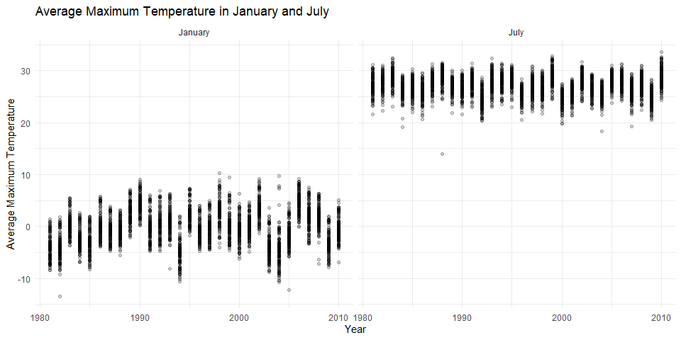
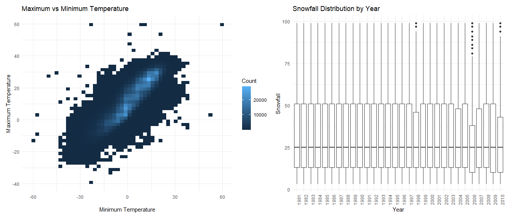
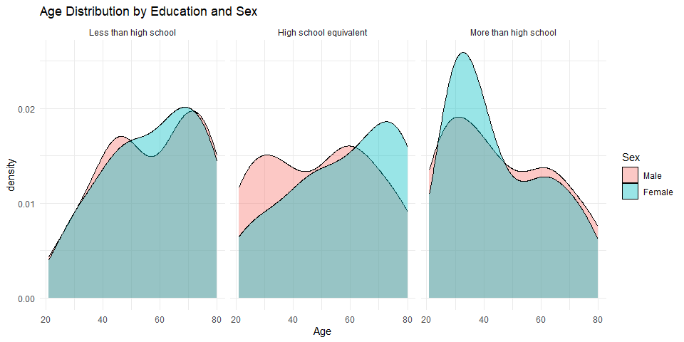
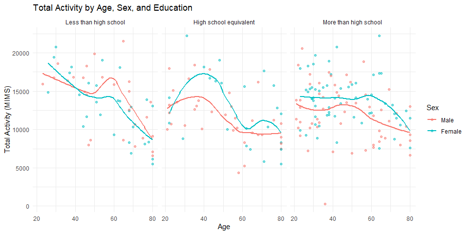
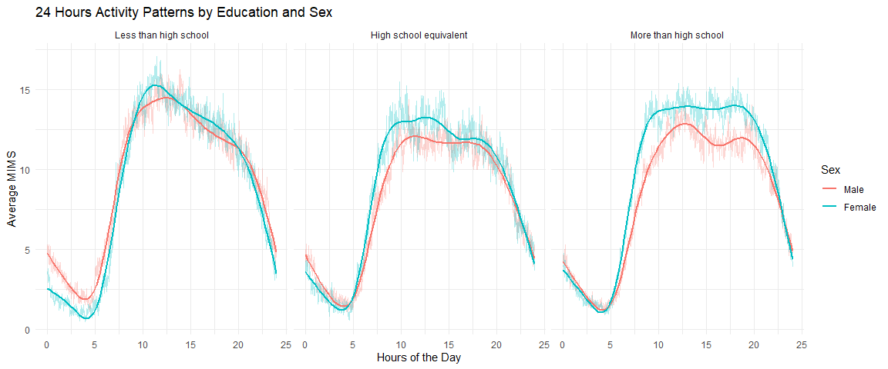
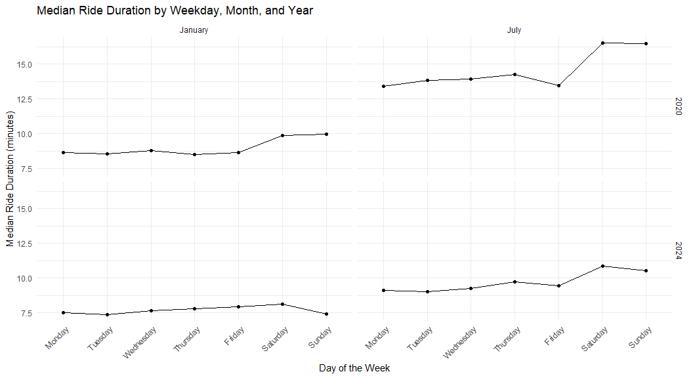
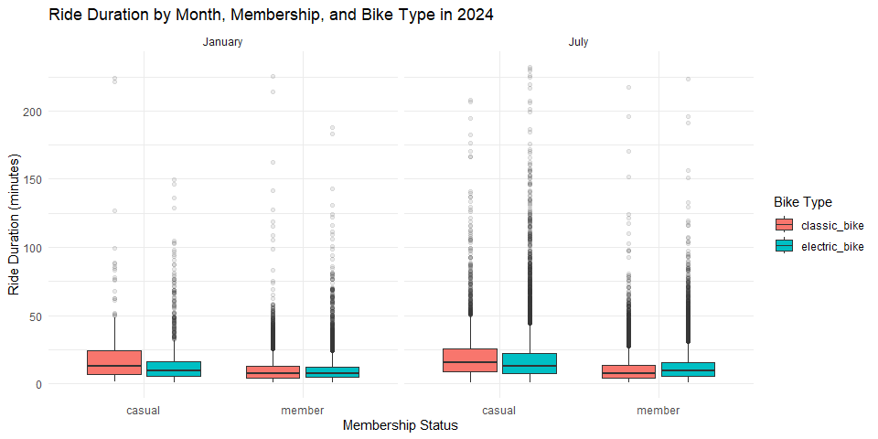

Homework 3
================
Haoyuan Dou
2026-10-19

# Problem 1

``` r
library(tidyverse)
```

    ## ── Attaching core tidyverse packages ──────────────────────── tidyverse 2.0.0 ──
    ## ✔ dplyr     1.2.1     ✔ readr     2.2.0
    ## ✔ forcats   1.0.1     ✔ stringr   1.6.0
    ## ✔ ggplot2   4.0.3     ✔ tibble    3.3.1
    ## ✔ lubridate 1.9.5     ✔ tidyr     1.3.2
    ## ✔ purrr     1.2.2     
    ## ── Conflicts ────────────────────────────────────────── tidyverse_conflicts() ──
    ## ✖ dplyr::filter() masks stats::filter()
    ## ✖ dplyr::lag()    masks stats::lag()
    ## ℹ Use the conflicted package (<http://conflicted.r-lib.org/>) to force all conflicts to become errors

``` r
library(p8105.datasets)
library(patchwork)
data("ny_noaa")
```

``` r
glimpse(ny_noaa)
```

    ## Rows: 2,595,176
    ## Columns: 7
    ## $ id   <chr> "US1NYAB0001", "US1NYAB0001", "US1NYAB0001", "US1NYAB0001", "US1N…
    ## $ date <date> 2007-11-01, 2007-11-02, 2007-11-03, 2007-11-04, 2007-11-05, 2007…
    ## $ prcp <int> NA, NA, NA, NA, NA, NA, NA, NA, NA, NA, NA, NA, NA, NA, NA, NA, 3…
    ## $ snow <int> NA, NA, NA, NA, NA, NA, NA, NA, NA, NA, NA, NA, NA, NA, NA, NA, 3…
    ## $ snwd <int> NA, NA, NA, NA, NA, NA, NA, NA, NA, NA, NA, NA, NA, NA, NA, NA, 0…
    ## $ tmax <chr> NA, NA, NA, NA, NA, NA, NA, NA, NA, NA, NA, NA, NA, NA, NA, NA, N…
    ## $ tmin <chr> NA, NA, NA, NA, NA, NA, NA, NA, NA, NA, NA, NA, NA, NA, NA, NA, N…

``` r
head(ny_noaa)
```

    ## # A tibble: 6 × 7
    ##   id          date        prcp  snow  snwd tmax  tmin 
    ##   <chr>       <date>     <int> <int> <int> <chr> <chr>
    ## 1 US1NYAB0001 2007-11-01    NA    NA    NA <NA>  <NA> 
    ## 2 US1NYAB0001 2007-11-02    NA    NA    NA <NA>  <NA> 
    ## 3 US1NYAB0001 2007-11-03    NA    NA    NA <NA>  <NA> 
    ## 4 US1NYAB0001 2007-11-04    NA    NA    NA <NA>  <NA> 
    ## 5 US1NYAB0001 2007-11-05    NA    NA    NA <NA>  <NA> 
    ## 6 US1NYAB0001 2007-11-06    NA    NA    NA <NA>  <NA>

``` r
colSums(is.na(ny_noaa))
```

    ##      id    date    prcp    snow    snwd    tmax    tmin 
    ##       0       0  145838  381221  591786 1134358 1134420

``` r
n_distinct(ny_noaa$id)
```

    ## [1] 747

``` r
range(ny_noaa$date)
```

    ## [1] "1981-01-01" "2010-12-31"

``` r
round(colMeans(is.na(ny_noaa)) * 100, 2)
```

    ##    id  date  prcp  snow  snwd  tmax  tmin 
    ##  0.00  0.00  5.62 14.69 22.80 43.71 43.71

The ny-noaa data set contains 2595176 observations and 7 variables from
747 weather stations in New York State between 1981 and 2010. The main
variables include precipitation (prcp), snowfall (snow), snow depth
(snwd), maximum temperature (tmax), and minimum temperature (tmin).
Precipitation is measured in tenths of a millimeter, and temperatures
are measured in tenths of a degree Celsius. Snowfall and snow depth are
already in millimeters.

There are many missing values in this data set. About 43.71% of
observations are missing for both maximum and minimum temperatures.
Snowfall and snow depth have 14.69% and 22.80% missing values,
respectively, while precipitation has about 5.62%. One possible reason
is that not all weather stations collect every type of measurement.

``` r
noaa_df = ny_noaa |>
  mutate(
    year = year(date),
    month = month(date),
    day = day(date),
    prcp = prcp / 10,
    tmax = as.numeric(tmax) / 10,
    tmin = as.numeric(tmin) / 10
  )

glimpse(noaa_df)
```

    ## Rows: 2,595,176
    ## Columns: 10
    ## $ id    <chr> "US1NYAB0001", "US1NYAB0001", "US1NYAB0001", "US1NYAB0001", "US1…
    ## $ date  <date> 2007-11-01, 2007-11-02, 2007-11-03, 2007-11-04, 2007-11-05, 200…
    ## $ prcp  <dbl> NA, NA, NA, NA, NA, NA, NA, NA, NA, NA, NA, NA, NA, NA, NA, NA, …
    ## $ snow  <int> NA, NA, NA, NA, NA, NA, NA, NA, NA, NA, NA, NA, NA, NA, NA, NA, …
    ## $ snwd  <int> NA, NA, NA, NA, NA, NA, NA, NA, NA, NA, NA, NA, NA, NA, NA, NA, …
    ## $ tmax  <dbl> NA, NA, NA, NA, NA, NA, NA, NA, NA, NA, NA, NA, NA, NA, NA, NA, …
    ## $ tmin  <dbl> NA, NA, NA, NA, NA, NA, NA, NA, NA, NA, NA, NA, NA, NA, NA, NA, …
    ## $ year  <dbl> 2007, 2007, 2007, 2007, 2007, 2007, 2007, 2007, 2007, 2007, 2007…
    ## $ month <dbl> 11, 11, 11, 11, 11, 11, 11, 11, 11, 11, 11, 11, 11, 11, 11, 11, …
    ## $ day   <int> 1, 2, 3, 4, 5, 6, 7, 8, 9, 10, 11, 12, 13, 14, 15, 16, 17, 18, 1…

``` r
head(noaa_df)
```

    ## # A tibble: 6 × 10
    ##   id          date        prcp  snow  snwd  tmax  tmin  year month   day
    ##   <chr>       <date>     <dbl> <int> <int> <dbl> <dbl> <dbl> <dbl> <int>
    ## 1 US1NYAB0001 2007-11-01    NA    NA    NA    NA    NA  2007    11     1
    ## 2 US1NYAB0001 2007-11-02    NA    NA    NA    NA    NA  2007    11     2
    ## 3 US1NYAB0001 2007-11-03    NA    NA    NA    NA    NA  2007    11     3
    ## 4 US1NYAB0001 2007-11-04    NA    NA    NA    NA    NA  2007    11     4
    ## 5 US1NYAB0001 2007-11-05    NA    NA    NA    NA    NA  2007    11     5
    ## 6 US1NYAB0001 2007-11-06    NA    NA    NA    NA    NA  2007    11     6

``` r
noaa_df |>
  count(snow, sort = TRUE) |>
  head(10)
```

    ## # A tibble: 10 × 2
    ##     snow       n
    ##    <int>   <int>
    ##  1     0 2008508
    ##  2    NA  381221
    ##  3    25   31022
    ##  4    13   23095
    ##  5    51   18274
    ##  6    76   10173
    ##  7     8    9962
    ##  8     5    9748
    ##  9    38    9197
    ## 10     3    8790

``` r
noaa_df |>
  filter(!is.na(snow)) |>
  count(snow, sort = TRUE) |>
  head(10)
```

    ## # A tibble: 10 × 2
    ##     snow       n
    ##    <int>   <int>
    ##  1     0 2008508
    ##  2    25   31022
    ##  3    13   23095
    ##  4    51   18274
    ##  5    76   10173
    ##  6     8    9962
    ##  7     5    9748
    ##  8    38    9197
    ##  9     3    8790
    ## 10   102    6552

The most common snowfall value is 0 mm, which appears 2008508 times.
This makes sense because most days do not have snowfall. Other common
values include 25, 13, 51, and 76mm. These values are close to 1, 0.5,
2, and 3 inches, respectively. I think these values may come from
measurements in inches that were later converted to millimeters.

``` r
temp_df = noaa_df |>
  filter(month %in% c(1, 7), !is.na(tmax)) |>
  group_by(id, year, month) |>
  summarize(
    mean_tmax = mean(tmax),
    .groups = "drop"
  )

glimpse(temp_df)
```

    ## Rows: 8,141
    ## Columns: 4
    ## $ id        <chr> "USC00300023", "USC00300023", "USC00300023", "USC00300023", …
    ## $ year      <dbl> 1981, 1981, 1982, 1982, 1983, 1983, 1984, 1985, 1989, 1990, …
    ## $ month     <dbl> 1, 7, 1, 7, 1, 7, 7, 1, 7, 1, 7, 7, 1, 7, 1, 7, 1, 7, 1, 7, …
    ## $ mean_tmax <dbl> -3.1652174, 28.2818182, -4.3222222, 27.8419355, 1.1129032, 2…

``` r
head(temp_df)
```

    ## # A tibble: 6 × 4
    ##   id           year month mean_tmax
    ##   <chr>       <dbl> <dbl>     <dbl>
    ## 1 USC00300023  1981     1     -3.17
    ## 2 USC00300023  1981     7     28.3 
    ## 3 USC00300023  1982     1     -4.32
    ## 4 USC00300023  1982     7     27.8 
    ## 5 USC00300023  1983     1      1.11
    ## 6 USC00300023  1983     7     29.8

``` r
temp_df |>
  mutate(
    month = factor(month,
                   levels = c(1, 7),
                   labels = c("January", "July"))
  ) |>
  ggplot(aes(x = year, y = mean_tmax)) + 
  geom_point(alpha = 0.2) +
  facet_grid(. ~ month) +
  labs(
    title = "Average Maximum Temperature in January and July",
    x = "Year",
    y = "Average Maximum Temperature"
  ) +
  theme_minimal()
```

<!-- -->

January and July have very different temperatrues, with July being much
warmer. Temperatures vary across years, but there is no clear increasing
or decreasing trend. One possible outlier is station USC00308962 in July
1988, with an average maximum temperature of about 13.95°C. This station
has temperature records for all 31 days in July, so the low average is
not due to missing daily observations.

``` r
temp_df |>
  filter(month == 7) |>
  arrange(mean_tmax) |>
  head(10)
```

    ## # A tibble: 10 × 4
    ##    id           year month mean_tmax
    ##    <chr>       <dbl> <dbl>     <dbl>
    ##  1 USC00308962  1988     7      14.0
    ##  2 USC00302454  2004     7      18.3
    ##  3 USC00308946  1984     7      19.1
    ##  4 USC00309389  2007     7      19.2
    ##  5 USC00306957  2000     7      19.8
    ##  6 USC00308248  2000     7      19.9
    ##  7 USC00308248  1992     7      20.3
    ##  8 USC00307799  2000     7      20.4
    ##  9 USC00307799  1992     7      20.4
    ## 10 USC00307799  1996     7      20.5

``` r
noaa_df |>
  filter(
    id == "USC00308962",
    year == 1988,
    month == 7,
    !is.na(tmax)
  ) |>
  summarize(
    n_days = n(),
    mean_tmax = mean(tmax)
  )
```

    ## # A tibble: 1 × 2
    ##   n_days mean_tmax
    ##    <int>     <dbl>
    ## 1     31      14.0

``` r
tmax_tmin_plot = noaa_df |>
  filter(!is.na(tmax), !is.na(tmin)) |>
  ggplot(aes(x = tmin, y = tmax)) +
  geom_bin2d(bins = 50) +
  labs(
    title = "Maximum vs Minimum Temperature",
    x = "Minimum Temperature",
    y = "Maximum Temperature",
    fill = "Count"
  ) +
  theme_minimal()
```

``` r
snow_plot = noaa_df |>
  filter(snow > 0, snow < 100) |>
  ggplot(aes(x = factor(year), y = snow)) +
  geom_boxplot() +
  labs(
    title = "Snowfall Distribution by Year",
    x = "Year",
    y = "Snowfall"
  ) +
  theme_minimal() +
  theme(
    axis.text.x = element_text(angle = 90, hjust = 1)
  )
```

``` r
tmax_tmin_plot + snow_plot
```

<!-- -->

The first plot shows a positive relationship between minimum and maximum
temperature. When the minimum temperature is higher, the maximum
temperature is usually higher too.I also notice a few points that are
far away from most of the data.

In the second plot, most years have similar snowfall distributions. The
median is around 25 mm in most years, but the spread is a little
different. For example, the distribution in 2006 appears lower than in
many other years. Overall, there is no clear trend in the distribution
of snowfall values between 0 and 100 mm over time.

# Problem 2

``` r
nhanes_covar = read_csv("data/nhanes_covar.csv", skip = 4)
```

    ## Rows: 250 Columns: 5
    ## ── Column specification ────────────────────────────────────────────────────────
    ## Delimiter: ","
    ## dbl (5): SEQN, sex, age, BMI, education
    ## 
    ## ℹ Use `spec()` to retrieve the full column specification for this data.
    ## ℹ Specify the column types or set `show_col_types = FALSE` to quiet this message.

``` r
nhanes_accel = read_csv("data/nhanes_accel.csv")
```

    ## Rows: 250 Columns: 1441
    ## ── Column specification ────────────────────────────────────────────────────────
    ## Delimiter: ","
    ## dbl (1441): SEQN, min1, min2, min3, min4, min5, min6, min7, min8, min9, min1...
    ## 
    ## ℹ Use `spec()` to retrieve the full column specification for this data.
    ## ℹ Specify the column types or set `show_col_types = FALSE` to quiet this message.

``` r
dim(nhanes_covar)
```

    ## [1] 250   5

``` r
dim(nhanes_accel)
```

    ## [1]  250 1441

``` r
glimpse(nhanes_covar)
```

    ## Rows: 250
    ## Columns: 5
    ## $ SEQN      <dbl> 62161, 62164, 62169, 62174, 62177, 62178, 62180, 62184, 6218…
    ## $ sex       <dbl> 1, 2, 1, 1, 1, 1, 1, 1, 2, 2, 1, 1, 2, 1, 1, 1, 2, 1, 2, 2, …
    ## $ age       <dbl> 22, 44, 21, 80, 51, 80, 35, 26, 17, 30, 70, 17, 16, 57, 36, …
    ## $ BMI       <dbl> 23.3, 23.2, 20.1, 33.9, 20.1, 28.5, 27.9, 22.1, 22.9, 22.4, …
    ## $ education <dbl> 2, 3, 2, 3, 2, 2, 3, 2, NA, 3, 2, NA, NA, 3, 1, 3, 3, 3, 1, …

``` r
names(nhanes_accel)[1:15]
```

    ##  [1] "SEQN"  "min1"  "min2"  "min3"  "min4"  "min5"  "min6"  "min7"  "min8" 
    ## [10] "min9"  "min10" "min11" "min12" "min13" "min14"

``` r
nhanes_covar_clean = nhanes_covar |>
  filter(
    age >= 21,
    !is.na(sex),
    !is.na(BMI),
    !is.na(education)
  ) |>
  mutate(
    sex = factor(
      sex,
      levels = c(1, 2),
      labels = c("Male", "Female")
    ),
    education = factor(
      education,
      levels = c(1, 2, 3),
      labels = c(
        "Less than high school",
        "High school equivalent",
        "More than high school"
      )
    )
  )

dim(nhanes_covar_clean)
```

    ## [1] 228   5

``` r
glimpse(nhanes_covar_clean)
```

    ## Rows: 228
    ## Columns: 5
    ## $ SEQN      <dbl> 62161, 62164, 62169, 62174, 62177, 62178, 62180, 62184, 6218…
    ## $ sex       <fct> Male, Female, Male, Male, Male, Male, Male, Male, Female, Ma…
    ## $ age       <dbl> 22, 44, 21, 80, 51, 80, 35, 26, 30, 57, 36, 28, 35, 38, 62, …
    ## $ BMI       <dbl> 23.3, 23.2, 20.1, 33.9, 20.1, 28.5, 27.9, 22.1, 22.4, 28.0, …
    ## $ education <fct> High school equivalent, More than high school, High school e…

``` r
table(nhanes_covar_clean$sex,
      nhanes_covar_clean$education)
```

    ##         
    ##          Less than high school High school equivalent More than high school
    ##   Male                      27                     35                    56
    ##   Female                    28                     23                    59

``` r
nhanes_df = nhanes_covar_clean |>
  left_join(nhanes_accel, by = "SEQN") |>
  pivot_longer(
    cols = min1:min1440,
    names_to = "minute",
    names_prefix = "min",
    values_to = "mims"
  ) |>
  mutate(
    minute = as.numeric(minute)
  )

dim(nhanes_df)
```

    ## [1] 328320      7

``` r
glimpse(nhanes_df)
```

    ## Rows: 328,320
    ## Columns: 7
    ## $ SEQN      <dbl> 62161, 62161, 62161, 62161, 62161, 62161, 62161, 62161, 6216…
    ## $ sex       <fct> Male, Male, Male, Male, Male, Male, Male, Male, Male, Male, …
    ## $ age       <dbl> 22, 22, 22, 22, 22, 22, 22, 22, 22, 22, 22, 22, 22, 22, 22, …
    ## $ BMI       <dbl> 23.3, 23.3, 23.3, 23.3, 23.3, 23.3, 23.3, 23.3, 23.3, 23.3, …
    ## $ education <fct> High school equivalent, High school equivalent, High school …
    ## $ minute    <dbl> 1, 2, 3, 4, 5, 6, 7, 8, 9, 10, 11, 12, 13, 14, 15, 16, 17, 1…
    ## $ mims      <dbl> 1.10600000, 3.11516667, 1.46750000, 0.93766667, 1.59866667, …

``` r
head(nhanes_df)
```

    ## # A tibble: 6 × 7
    ##    SEQN sex     age   BMI education              minute  mims
    ##   <dbl> <fct> <dbl> <dbl> <fct>                   <dbl> <dbl>
    ## 1 62161 Male     22  23.3 High school equivalent      1 1.11 
    ## 2 62161 Male     22  23.3 High school equivalent      2 3.12 
    ## 3 62161 Male     22  23.3 High school equivalent      3 1.47 
    ## 4 62161 Male     22  23.3 High school equivalent      4 0.938
    ## 5 62161 Male     22  23.3 High school equivalent      5 1.60 
    ## 6 62161 Male     22  23.3 High school equivalent      6 0.145

``` r
nhanes_covar_clean |>
  count(education, sex) |>
  pivot_wider(
    names_from = sex,
    values_from = n
  ) |>
  knitr::kable(
    caption = "Number of Participants by Education and Sex"
  )
```

| education              | Male | Female |
|:-----------------------|-----:|-------:|
| Less than high school  |   27 |     28 |
| High school equivalent |   35 |     23 |
| More than high school  |   56 |     59 |

Number of Participants by Education and Sex

``` r
nhanes_covar_clean |>
  ggplot(aes(x = age, fill = sex)) +
  geom_density(alpha = 0.4) +
  facet_grid(. ~ education) +
  labs(
    title = "Age Distribution by Education and Sex",
    x = "Age",
    fill = "Sex"
  ) +
  theme_minimal()
```

<!-- -->

The table shows that the group with more than high school education has
the largest number of participants (115). There are 118 men and 110
women in total, so the number are pretty close. The high school
equivalent group has more men than women.

People in the less than high school group seem to be older. In the more
than high school group, there is a peak around age 30, especially for
women. In the high school equivalent group, women appear more
concentrated at older ages than men.

``` r
activity_df = nhanes_df |>
  group_by(SEQN, sex, age, education) |>
  summarize(
    total_activity = sum(mims, na.rm = TRUE),
    .groups = "drop"
  )

dim(activity_df)
```

    ## [1] 228   5

``` r
glimpse(activity_df)
```

    ## Rows: 228
    ## Columns: 5
    ## $ SEQN           <dbl> 62161, 62164, 62169, 62174, 62177, 62178, 62180, 62184,…
    ## $ sex            <fct> Male, Female, Male, Male, Male, Male, Male, Male, Femal…
    ## $ age            <dbl> 22, 44, 21, 80, 51, 80, 35, 26, 30, 57, 36, 28, 35, 38,…
    ## $ education      <fct> High school equivalent, More than high school, High sch…
    ## $ total_activity <dbl> 13194.086, 13411.411, 9991.222, 8579.092, 11917.970, 74…

``` r
head(activity_df)
```

    ## # A tibble: 6 × 5
    ##    SEQN sex      age education              total_activity
    ##   <dbl> <fct>  <dbl> <fct>                           <dbl>
    ## 1 62161 Male      22 High school equivalent         13194.
    ## 2 62164 Female    44 More than high school          13411.
    ## 3 62169 Male      21 High school equivalent          9991.
    ## 4 62174 Male      80 More than high school           8579.
    ## 5 62177 Male      51 High school equivalent         11918.
    ## 6 62178 Male      80 High school equivalent          7489.

``` r
activity_df |>
  ggplot(aes(x = age, y = total_activity, color = sex)) +
  geom_point(alpha = 0.5) +
  geom_smooth(se = FALSE) +
  facet_grid(. ~ education) +
  labs(
    title = "Total Activity by Age, Sex, and Education",
    x = "Age",
    y = "Total Activity (MIMS)",
    color = "Sex"
  ) +
  theme_minimal()
```

    ## `geom_smooth()` using method = 'loess' and formula = 'y ~ x'

<!-- -->

The plot shows that total activity generally decreases with age across
all three education groups. In the less than high school group, both men
and women show a noticeable decline at older ages. In the high school
equivalent group, women’s activity seems to reach a peak around age 40
and then decreases. In the more than high school group, activity levels
are relatively stable at younger and middle ages, but decrease among
older participants. I don’t see the same difference between men and wmen
inevery education group.

``` r
activity_time_df = nhanes_df |>
  group_by(education, sex, minute) |>
  summarize(
    mean_mims = mean(mims, na.rm = TRUE),
    .groups = "drop"
  ) |>
  mutate(
    hour = (minute - 1) / 60
  )

dim(activity_time_df)
```

    ## [1] 8640    5

``` r
glimpse(activity_time_df)
```

    ## Rows: 8,640
    ## Columns: 5
    ## $ education <fct> Less than high school, Less than high school, Less than high…
    ## $ sex       <fct> Male, Male, Male, Male, Male, Male, Male, Male, Male, Male, …
    ## $ minute    <dbl> 1, 2, 3, 4, 5, 6, 7, 8, 9, 10, 11, 12, 13, 14, 15, 16, 17, 1…
    ## $ mean_mims <dbl> 5.307998, 5.058136, 4.721575, 5.016635, 4.549996, 4.883183, …
    ## $ hour      <dbl> 0.00000000, 0.01666667, 0.03333333, 0.05000000, 0.06666667, …

``` r
head(activity_time_df)
```

    ## # A tibble: 6 × 5
    ##   education             sex   minute mean_mims   hour
    ##   <fct>                 <fct>  <dbl>     <dbl>  <dbl>
    ## 1 Less than high school Male       1      5.31 0     
    ## 2 Less than high school Male       2      5.06 0.0167
    ## 3 Less than high school Male       3      4.72 0.0333
    ## 4 Less than high school Male       4      5.02 0.05  
    ## 5 Less than high school Male       5      4.55 0.0667
    ## 6 Less than high school Male       6      4.88 0.0833

``` r
activity_time_df |>
  ggplot(aes(x = hour, y = mean_mims, color = sex)) +
  geom_line(alpha = 0.3) +
  geom_smooth(se = FALSE) +
  facet_grid(. ~ education) +
  labs(
    title = "24 Hours Activity Patterns by Education and Sex",
    x = "Hours of the Day",
    y = "Average MIMS",
    color = "Sex"
  ) +
  theme_minimal()
```

    ## `geom_smooth()` using method = 'gam' and formula = 'y ~ s(x, bs = "cs")'

<!-- -->

The plot shows a similar daily activity pattern across all three
education groups. Activity levels are lowest during the early morning,
around 3 to 5 AM, and then increase quickly in the morning. They remain
relatively high during the day and gradually decrease in the evening.

Women generally have slightly higher average activity levels than men
during the daytime, especially in the high school equivalent and more
than high school groups. In the less than high school group, activity
peaks in the late morning and then gradually decreases. The other two
groups stay at relatively high activity levels for more hours during the
day.

# Problem 3

``` r
citibike_files = list.files(
  path = "data/citibike",
  pattern = "\\.csv$",
  full.names = TRUE,
  recursive = TRUE
)

citibike_files
```

    ## [1] "data/citibike/citibike/Jan 2020 Citi.csv/Jan 2020 Citi.csv"  
    ## [2] "data/citibike/citibike/Jan 2024 Citi.csv/Jan 2024 Citi.csv"  
    ## [3] "data/citibike/citibike/July 2020 Citi.csv/July 2020 Citi.csv"
    ## [4] "data/citibike/citibike/July 2024 Citi.csv/July 2024 Citi.csv"

``` r
citibike_2020 = read_csv(citibike_files[1])
```

    ## Rows: 12420 Columns: 7
    ## ── Column specification ────────────────────────────────────────────────────────
    ## Delimiter: ","
    ## chr (6): ride_id, rideable_type, weekdays, start_station_name, end_station_n...
    ## dbl (1): duration
    ## 
    ## ℹ Use `spec()` to retrieve the full column specification for this data.
    ## ℹ Specify the column types or set `show_col_types = FALSE` to quiet this message.

``` r
citibike_2024 = read_csv(citibike_files[4])
```

    ## Rows: 47156 Columns: 7
    ## ── Column specification ────────────────────────────────────────────────────────
    ## Delimiter: ","
    ## chr (6): ride_id, rideable_type, weekdays, start_station_name, end_station_n...
    ## dbl (1): duration
    ## 
    ## ℹ Use `spec()` to retrieve the full column specification for this data.
    ## ℹ Specify the column types or set `show_col_types = FALSE` to quiet this message.

``` r
dim(citibike_2020)
```

    ## [1] 12420     7

``` r
dim(citibike_2024)
```

    ## [1] 47156     7

``` r
glimpse(citibike_2020)
```

    ## Rows: 12,420
    ## Columns: 7
    ## $ ride_id            <chr> "4BE06CB33B037044", "26886E034974493B", "24DC56060E…
    ## $ rideable_type      <chr> "classic_bike", "classic_bike", "classic_bike", "cl…
    ## $ weekdays           <chr> "Tuesday", "Wednesday", "Friday", "Sunday", "Friday…
    ## $ duration           <dbl> 15.333267, 5.309467, 9.691800, 6.996183, 2.849500, …
    ## $ start_station_name <chr> "Columbus Ave & W 95 St", "2 Ave & E 96 St", "Colum…
    ## $ end_station_name   <chr> "E 53 St & Madison Ave", "1 Ave & E 110 St", "Grand…
    ## $ member_casual      <chr> "member", "member", "member", "member", "member", "…

``` r
glimpse(citibike_2024)
```

    ## Rows: 47,156
    ## Columns: 7
    ## $ ride_id            <chr> "86AE148E36FBF035", "FCF07A30F66B9B07", "D8397E843C…
    ## $ rideable_type      <chr> "classic_bike", "electric_bike", "classic_bike", "e…
    ## $ weekdays           <chr> "Sunday", "Thursday", "Thursday", "Tuesday", "Wedne…
    ## $ duration           <dbl> 19.661183, 7.676433, 24.465950, 3.528600, 24.126050…
    ## $ start_station_name <chr> "Picnic Point", "W 54 St & 9 Ave", "12 Ave & W 40 S…
    ## $ end_station_name   <chr> "Yankee Ferry Terminal", "W 42 St & 8 Ave", "W 84 S…
    ## $ member_casual      <chr> "casual", "casual", "member", "member", "casual", "…

``` r
citibike_df = bind_rows(
  citibike_2020 |>
    mutate(year = 2020, month = "January"),
  read_csv(citibike_files[2]) |>
    mutate(year = 2024, month = "January"),
  read_csv(citibike_files[3]) |>
    mutate(year = 2020, month = "July"),
  citibike_2024 |>
    mutate(year = 2024, month = "July")
)
```

    ## Rows: 18861 Columns: 7
    ## ── Column specification ────────────────────────────────────────────────────────
    ## Delimiter: ","
    ## chr (6): ride_id, rideable_type, weekdays, start_station_name, end_station_n...
    ## dbl (1): duration
    ## 
    ## ℹ Use `spec()` to retrieve the full column specification for this data.
    ## ℹ Specify the column types or set `show_col_types = FALSE` to quiet this message.
    ## Rows: 21048 Columns: 7
    ## ── Column specification ────────────────────────────────────────────────────────
    ## Delimiter: ","
    ## chr (6): ride_id, rideable_type, weekdays, start_station_name, end_station_n...
    ## dbl (1): duration
    ## 
    ## ℹ Use `spec()` to retrieve the full column specification for this data.
    ## ℹ Specify the column types or set `show_col_types = FALSE` to quiet this message.

``` r
dim(citibike_df)
```

    ## [1] 99485     9

``` r
glimpse(citibike_df)
```

    ## Rows: 99,485
    ## Columns: 9
    ## $ ride_id            <chr> "4BE06CB33B037044", "26886E034974493B", "24DC56060E…
    ## $ rideable_type      <chr> "classic_bike", "classic_bike", "classic_bike", "cl…
    ## $ weekdays           <chr> "Tuesday", "Wednesday", "Friday", "Sunday", "Friday…
    ## $ duration           <dbl> 15.333267, 5.309467, 9.691800, 6.996183, 2.849500, …
    ## $ start_station_name <chr> "Columbus Ave & W 95 St", "2 Ave & E 96 St", "Colum…
    ## $ end_station_name   <chr> "E 53 St & Madison Ave", "1 Ave & E 110 St", "Grand…
    ## $ member_casual      <chr> "member", "member", "member", "member", "member", "…
    ## $ year               <dbl> 2020, 2020, 2020, 2020, 2020, 2020, 2020, 2020, 202…
    ## $ month              <chr> "January", "January", "January", "January", "Januar…

``` r
citibike_df |>
  count(year, month)
```

    ## # A tibble: 4 × 3
    ##    year month       n
    ##   <dbl> <chr>   <int>
    ## 1  2020 January 12420
    ## 2  2020 July    21048
    ## 3  2024 January 18861
    ## 4  2024 July    47156

``` r
colSums(is.na(citibike_df))
```

    ##            ride_id      rideable_type           weekdays           duration 
    ##                  0                  0                  0                  0 
    ## start_station_name   end_station_name      member_casual               year 
    ##                 43                207                  0                  0 
    ##              month 
    ##                  0

``` r
summary(citibike_df$duration)
```

    ##    Min. 1st Qu.  Median    Mean 3rd Qu.    Max. 
    ##   1.002   5.595   9.839  13.930  17.560 238.780

``` r
citibike_df |>
  count(rideable_type, member_casual)
```

    ## # A tibble: 4 × 3
    ##   rideable_type member_casual     n
    ##   <chr>         <chr>         <int>
    ## 1 classic_bike  casual         9953
    ## 2 classic_bike  member        45583
    ## 3 electric_bike casual         9670
    ## 4 electric_bike member        34279

``` r
citibike_df |>
  count(weekdays)
```

    ## # A tibble: 7 × 2
    ##   weekdays      n
    ##   <chr>     <int>
    ## 1 Friday    13634
    ## 2 Monday    14499
    ## 3 Saturday  12435
    ## 4 Sunday    11486
    ## 5 Thursday  15023
    ## 6 Tuesday   15524
    ## 7 Wednesday 16884

``` r
citibike_clean = citibike_df |>
  mutate(
    weekdays = factor(
      weekdays,
      levels = c("Monday", "Tuesday", "Wednesday", 
                 "Thursday", "Friday", "Saturday", "Sunday")
    ),
    month = factor(
      month,
      levels = c("January", "July")
    ),
    member_casual = factor(member_casual),
    rideable_type = factor(rideable_type)
  )

dim(citibike_clean)
```

    ## [1] 99485     9

``` r
glimpse(citibike_clean)
```

    ## Rows: 99,485
    ## Columns: 9
    ## $ ride_id            <chr> "4BE06CB33B037044", "26886E034974493B", "24DC56060E…
    ## $ rideable_type      <fct> classic_bike, classic_bike, classic_bike, classic_b…
    ## $ weekdays           <fct> Tuesday, Wednesday, Friday, Sunday, Friday, Sunday,…
    ## $ duration           <dbl> 15.333267, 5.309467, 9.691800, 6.996183, 2.849500, …
    ## $ start_station_name <chr> "Columbus Ave & W 95 St", "2 Ave & E 96 St", "Colum…
    ## $ end_station_name   <chr> "E 53 St & Madison Ave", "1 Ave & E 110 St", "Grand…
    ## $ member_casual      <fct> member, member, member, member, member, member, mem…
    ## $ year               <dbl> 2020, 2020, 2020, 2020, 2020, 2020, 2020, 2020, 202…
    ## $ month              <fct> January, January, January, January, January, Januar…

The Citi Bike data set contains 99485 rides and 9 variables from January
and July in 2020 and 2024. The variables include ride duration, bike
type, weekday, starting and ending stations, and membership status.The
median tide duration is about 9.84 minutes, and the mean is about 13.93
minutes. These data are a 1% sample of rides that lasted less than 4
hours.

There are not many missing values in this data set. The starting station
name has 43 missing values, and the ending station name has 207. Other
variables have no missing values.

``` r
citibike_clean |>
  count(year, month, member_casual) |>
  pivot_wider(
    names_from = member_casual,
    values_from = n
  ) |>
  knitr::kable(
    caption = "Number of Citi Bike Rides by Year, Month, and Membership"
  )
```

| year | month   | casual | member |
|-----:|:--------|-------:|-------:|
| 2020 | January |    984 |  11436 |
| 2020 | July    |   5637 |  15411 |
| 2024 | January |   2108 |  16753 |
| 2024 | July    |  10894 |  36262 |

Number of Citi Bike Rides by Year, Month, and Membership

The table shows that there are more rides in July than in January for
both years. The number of rides is also higher in2024 compared with
2020. Members have more rides than casual riders in all four months.
July 2024 has the highest number of rides, especially among members.

``` r
citibike_clean |>
  filter(
    year == 2024,
    month == "July",
    !is.na(start_station_name)
  ) |>
  count(start_station_name, sort = TRUE) |>
  head(5) |>
  knitr::kable(
    caption = "Top 5 Starting Stations in July 2024"
  )
```

| start_station_name       |   n |
|:-------------------------|----:|
| Pier 61 at Chelsea Piers | 163 |
| University Pl & E 14 St  | 155 |
| W 21 St & 6 Ave          | 152 |
| West St & Chambers St    | 150 |
| W 31 St & 7 Ave          | 146 |

Top 5 Starting Stations in July 2024

``` r
citibike_median = citibike_clean |>
  group_by(year, month, weekdays) |>
  summarize(
    median_duration = median(duration),
    .groups = "drop"
  )

dim(citibike_median)
```

    ## [1] 28  4

``` r
head(citibike_median)
```

    ## # A tibble: 6 × 4
    ##    year month   weekdays  median_duration
    ##   <dbl> <fct>   <fct>               <dbl>
    ## 1  2020 January Monday               8.66
    ## 2  2020 January Tuesday              8.57
    ## 3  2020 January Wednesday            8.80
    ## 4  2020 January Thursday             8.50
    ## 5  2020 January Friday               8.64
    ## 6  2020 January Saturday             9.88

``` r
citibike_median |>
  ggplot(aes(x = weekdays, y = median_duration, group = 1)) +
  geom_line() +
  geom_point() +
  facet_grid(year ~ month) +
  labs(
    title = "Median Ride Duration by Weekday, Month, and Year",
    x = "Day of the Week",
    y = "Median Ride Duration (minutes)"
  ) +
  theme_minimal() +
  theme(
    axis.text.x = element_text(angle = 45, hjust = 1)
  )
```

<!-- -->

The plot shows that median ride duration is longer in July than in
January for both years. Weekend rides are usually longer than weekday
rides, especially in July 2020. I also notice that ride duration is
generally shorter in 2024 compared with 2020. The difference is more
obvious in July, where median ride duration in 2020 is much higher than
in 2024.

``` r
citibike_2024_df = citibike_clean |>
  filter(year == 2024)

citibike_2024_df |>
  group_by(month, member_casual, rideable_type) |>
  summarize(
    n = n(),
    median_duration = median(duration),
    .groups = "drop"
  )
```

    ## # A tibble: 8 × 5
    ##   month   member_casual rideable_type     n median_duration
    ##   <fct>   <fct>         <fct>         <int>           <dbl>
    ## 1 January casual        classic_bike    456           12.7 
    ## 2 January casual        electric_bike  1652            9.34
    ## 3 January member        classic_bike   6252            7.32
    ## 4 January member        electric_bike 10501            7.58
    ## 5 July    casual        classic_bike   3133           15.6 
    ## 6 July    casual        electric_bike  7761           12.9 
    ## 7 July    member        classic_bike  13165            7.68
    ## 8 July    member        electric_bike 23097            9.24

``` r
citibike_2024_df |>
  ggplot(aes(x = member_casual, y = duration, 
             fill = rideable_type)) +
  geom_boxplot(outlier.alpha = 0.1) +
  facet_grid(. ~ month) +
  labs(
    title = "Ride Duration by Month, Membership, and Bike Type in 2024",
    x = "Membership Status",
    y = "Ride Duration (minutes)",
    fill = "Bike Type"
  ) +
  theme_minimal()
```

<!-- -->

Casual riders usually have longer rides than members in both January and
July. I also notice that rides tend to be longer in July. For casual
riders, classic bikes have a higher median ride duration than electric
bikes. However, the difference between bike types is smaller for
members. There are also many long rides outside the boxes, especially
for casual riders.
